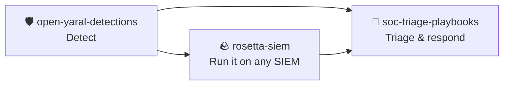

---

## 👋 About me

I'm a **Security Engineer on the defender side**. I build detections, design SOC workflows and harden the systems that hold an organization's most sensitive data and keys.

- 🛡️ **SIEM / SOAR:** Google Security Operations (Chronicle), YARA-L 2.0, UDM, detection-as-code
- 🗄️ **Database Activity Monitoring:** IBM Guardium policies, SQL threat detection, data-access governance
- 🔐 **Cryptography & HSMs:** Thales Luna HSM, CipherTrust Manager, PKI and key custody
- 📚 **Learning in public:** I explain security concepts clearly and turn them into tools other defenders can use

## 🚀 Featured projects

<table>
<tr>
<td width="33%" valign="top">

### 🛡️ [open-yaral-detections](https://github.com/<your-username>/open-yaral-detections)
The largest open YARA-L 2.0 library for Google SecOps: **237 ATT&CK-mapped rules** across Windows, Linux, AWS, Azure, Entra, GCP, FortiGate, Cisco, CrowdStrike, SentinelOne, Defender, F5, Guardium, DLP, CyberArk, ARCON and Thales HSMs. Includes 7 dashboards and a searchable web gallery.

</td>
<td width="33%" valign="top">

### 🧭 [soc-triage-playbooks](https://github.com/<your-username>/soc-triage-playbooks)
**23 decision-tree playbooks** that turn an alert into a verdict: Mermaid flowcharts, UDM pivot queries, TP/FP indicators, containment and escalation steps. Covers identity, endpoint, cloud, network, DAM, DLP, PAM and HSM.

</td>
<td width="33%" valign="top">

### 🪨 [rosetta-siem](https://github.com/<your-username>/rosetta-siem)
Translate detection queries between **YARA-L ⇄ KQL ⇄ SPL ⇄ AQL**, in any direction. Zero dependencies, round-trip tested, and it warns explicitly instead of silently mistranslating. Converts 235 of the 237 rules in the library.

</td>
</tr>
</table>

## 🧰 Tech I work with

**Security platforms**

**Languages & frameworks**

**Compliance context:** PCI DSS · SOC 2 · HIPAA · GDPR

## 📊 GitHub stats

&show_icons=true&hide_border=true&theme=tokyonight" alt="GitHub stats"/>
&layout=compact&hide_border=true&theme=tokyonight" alt="Top languages"/>

## 🌱 Currently

- 🔭 Expanding detection coverage: Okta, Kubernetes, Palo Alto and Zscaler packs
- 🧪 Building a browser playground for rosetta-siem
- ✍️ Writing deep-dives on DAM and HSM monitoring, two areas few people publish about

## 🤝 Let's collaborate

Open to collaborating on **detection engineering, SOC automation and data-security monitoring**. If one of my projects helped your team, a ⭐ helps other defenders find it. PRs with new rules and playbooks are always welcome.

